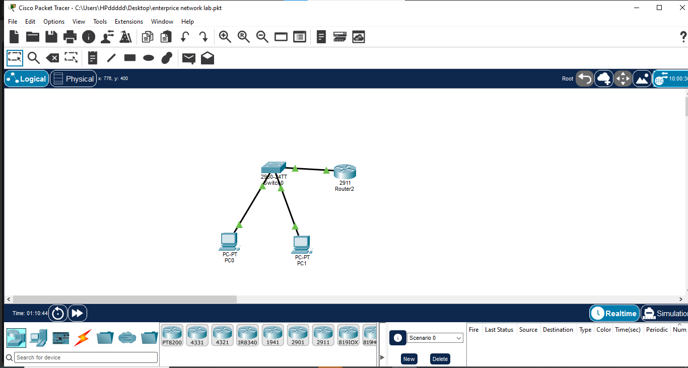

# Network Topology and Device Inventory

## 1. Project Overview

This document describes the current network topology of the Enterprise Network Lab built in Cisco Packet Tracer.

The network is a work in progress. The current topology contains two PCs, one Layer 2 switch, and one router.

## 2. Device Inventory

| Device | Model | Role |
|---|---|---|
| PC0 | PC-PT | End device |
| PC1 | PC-PT | End device |
| Switch0 | Cisco Catalyst 2960-24TT | Layer 2 switching |
| Router2 | Cisco 2911 | Routing |

## 3. Physical Connections

| Source Device | Destination Device | Purpose |
|---|---|---|
| PC0 | Switch0 | Connects the first PC to the LAN |
| PC1 | Switch0 | Connects the second PC to the LAN |
| Router2 | Switch0 | Connects the router to the switch |

Exact interface assignments will be recorded after verification.

## 4. Current Status

- The four devices are present in the Packet Tracer topology.
- The initial two-PC LAN was tested successfully.
- VLANs 10 (ADMIN) and 20 (HR) have been created on the switch.
- Router-to-switch connectivity and trunk configuration require verification.
- Inter-VLAN routing has not yet been verified.

## 5. Verification

The physical links appear active in the captured topology. Green link indicators alone do not prove that routing or end-to-end connectivity works.

Additional interface checks and connectivity tests will be documented as the project progresses.
## 6. Network Topology Diagram

The following diagram shows the initial network topology built in Cisco Packet Tracer.


## Current Implementation: VLANs and Inter-VLAN Routing

### Status

**Completed and tested in Cisco Packet Tracer.**

### Current topology

The current lab contains two PCs, one Cisco Catalyst 2960 switch, and one Cisco 2911 router.

* PC0 connects to Switch0 on FastEthernet0/1.
* PC1 connects to Switch0 on FastEthernet0/2.
* Switch0 GigabitEthernet0/1 connects to Router2 GigabitEthernet0/0.
* The switch-to-router link carries VLAN traffic using IEEE 802.1Q trunking.
* Router-on-a-stick provides routing between VLAN 10 and VLAN 20.

### VLAN and IP addressing table

| Device          | VLAN       | IP address    | Subnet mask   | Default gateway |
| --------------- | ---------- | ------------- | ------------- | --------------- |
| PC0             | 10 - ADMIN | 192.168.10.10 | 255.255.255.0 | 192.168.10.1    |
| Router2 G0/0.10 | 10 - ADMIN | 192.168.10.1  | 255.255.255.0 | N/A             |
| PC1             | 20 - HR    | 192.168.20.11 | 255.255.255.0 | 192.168.20.1    |
| Router2 G0/0.20 | 20 - HR    | 192.168.20.1  | 255.255.255.0 | N/A             |

### Switch port assignments

| Switch port | Connected device | Configuration        |
| ----------- | ---------------- | -------------------- |
| Fa0/1       | PC0              | Access port, VLAN 10 |
| Fa0/2       | PC1              | Access port, VLAN 20 |
| Gi0/1       | Router2 G0/0     | 802.1Q trunk         |

### Router-on-a-stick configuration

The router uses subinterfaces on GigabitEthernet0/0 to route traffic between VLANs.

```text
interface GigabitEthernet0/0
 no shutdown
!
interface GigabitEthernet0/0.10
 encapsulation dot1Q 10
 ip address 192.168.10.1 255.255.255.0
!
interface GigabitEthernet0/0.20
 encapsulation dot1Q 20
 ip address 192.168.20.1 255.255.255.0
```

### Verification

The following tests were completed successfully in Cisco Packet Tracer:

* PC0 reached its default gateway at 192.168.10.1.
* PC1 reached its default gateway at 192.168.20.1.
* PC1 reached PC0 at 192.168.10.10 across VLANs.
* The gateway ping tests returned four replies with 0% packet loss.

### Current limitations and next steps

This is an intermediate milestone, not the final enterprise network. The following remain planned:

* Add the remaining department VLANs and Management VLAN 99.
* Implement access-control lists (ACLs) and switch port security.
* Secure device management access.
* Expand testing and troubleshooting evidence.
* Complete the final topology and project documentation.

Security controls and the additional VLANs have not yet been implemented in this milestone.

